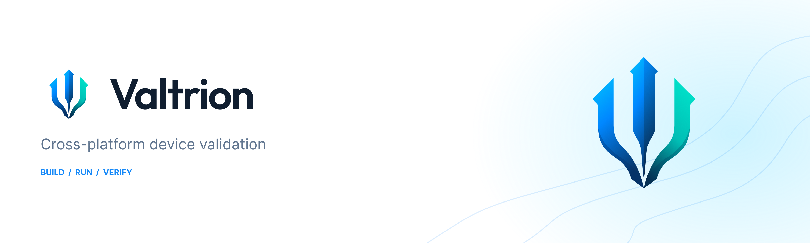
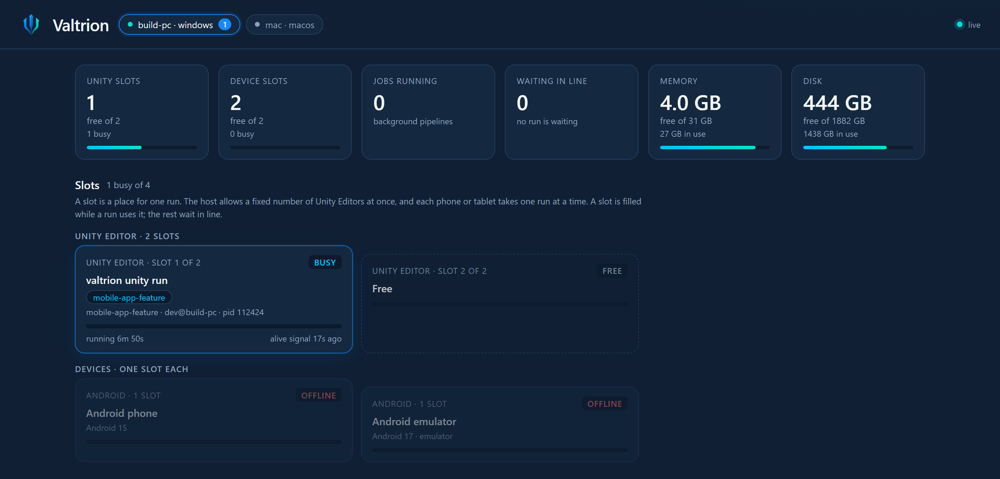

<p align="center">
  <picture>
    <source media="(prefers-color-scheme: dark)" srcset="publishing/assets/valtrion-readme-dark.png">
    
  </picture>
</p>

# Valtrion

**Run a test or app check as a supervised job: with a time limit, hang detection, a clear result and saved logs.**

When a check hangs, fails halfway or runs on another machine, all you have is terminal scrollback. Valtrion runs the command for you, stops it when it takes too long or stops making progress, and keeps the status, events and console output so you can see what actually ran.

It works with any command. For Unity apps it also runs test plans inside the app and collects screenshots and metrics.

## How it works

1. You give Valtrion a command: your tests, a data check, or a Unity plan.
2. It runs the command on this machine or on an SSH host you configured, with limits you set.
3. It ends the job with one result (`PASS`, `FAIL`, `TIMEOUT`, or `STALL` when there was no progress for too long) and writes `job.json`, `events.jsonl` and `console.log`.

Your command supplies the assertions. For a plain command, `PASS` means it exited with code 0.

## Install

You need Python 3.10 or newer. The command-line tool ("Core") has no other dependencies.

```sh
pipx install valtrion
valtrion --version
```

No `pipx`? See [installation](docs/install.md) for a virtual-environment install.

Using Unity? Add the package from Git: Window → Package Manager → + → Add package from git URL:

```text
https://github.com/GORYNED/Valtrion.git?path=integrations/unity/com.goryned.valtrion.unity#unity-v0.12.0
```

The Unity package has its own version. [compat.json](compat.json) lists which Core versions it works with, and `valtrion doctor --project <Unity project>` checks the pair.

## Try it in a minute

A check that passes:

```sh
valtrion job start --project demo --label hello --timeout-sec 30 --stall-sec 10 --watch -- python -c "print('hello')"
```

The last line is `GDV-RESULT PASS job=...` and the exit code is 0. A command that hangs is stopped instead of waiting forever:

```sh
valtrion job start --project demo --label hang --timeout-sec 60 --stall-sec 5 --watch -- python -c "import time; time.sleep(600)"
```

The result is `STALL`: no progress for 5 seconds. The job directory printed at the start holds the evidence.

More: the [Quick Start](docs/quick-start.md) covers a real failure, a timeout and how to read the results.

## See what is running

```sh
valtrion dashboard
```

A page opens (and, on Windows, an icon appears in the tray) that shows what is happening right now: which Unity runs and devices are busy, how far the tests have come, how much memory and disk are left, and who is waiting. It only shows; it changes nothing. [More](docs/cli.md#dashboard).

<p align="center">
  
</p>

## Update

```sh
pipx upgrade valtrion
```

For Unity, change the tag at the end of the Git URL in `Packages/manifest.json` to a newer `unity-vX.Y.Z`, then run `valtrion doctor`. Read the [Core](CHANGELOG.md) and [Unity](integrations/unity/com.goryned.valtrion.unity/CHANGELOG.md) changelogs first.

## Let an AI agent set it up

Copy the prompt from [AI-agent setup](docs/ai-agent-setup.md) into Claude Code, Codex or another coding agent. It picks the right path for your project and reports what it verified. The [detailed guide](docs/ai-agent-setup-detailed.md) is for agents that need the full steps.

## What you get today

| Area | What it provides |
| --- | --- |
| Command jobs | Local or SSH execution, timeouts, stall detection, locks for shared devices, saved logs and events |
| Unity integration | Plan steps inside the Editor or a development player: C# steps, heartbeat, results, metrics, screenshots |
| App pipelines | Build, install, run and collect on the Editor, Android, iOS, Windows and macOS (see [providers](docs/providers.md)) (your project supplies the build and test entry points) |
| Reviewing a change | Choosing which checks to run, and comparing metrics with a saved baseline |

## Status and limits

Valtrion is pre-release software under the [MIT license](LICENSE). Core 0.15.0 and Unity package 0.12.0 are GitHub Pre-releases (Core is also on PyPI), and the CLI may change before a stable release. The [release-readiness record](docs/release-readiness.md) lists tested environments and known gaps.

- Unity is the only application integration. Other engines can use command jobs only. The Unity package needs Unity 6000.6 or newer.
- Standalone `install`, `launch`, `push`, `pull`, `screenshot` and `logs` commands are not implemented yet. Use `run` or `pipeline` workflows. `build` (build only, published and reused by key) is implemented.
- Checks run trusted code with your permissions. Read the [trust model](docs/trust-model.md) before using an unfamiliar project or remote host.

## Learn more

[Quick Start](docs/quick-start.md) · [Unity Quick Start](docs/unity-quick-start.md) · [Installation](docs/install.md) · [CLI](docs/cli.md) · [Overview](docs/overview.md) · [Providers](docs/providers.md) · [Unity package](integrations/unity/com.goryned.valtrion.unity/Documentation~/index.md) · [Architecture](docs/ARCHITECTURE.md) · [Releasing](docs/releasing.md) · [Roadmap](ROADMAP.md)

Development: [CONTRIBUTING.md](CONTRIBUTING.md). Vulnerabilities: [SECURITY.md](SECURITY.md).
